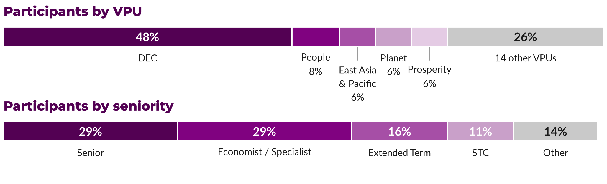
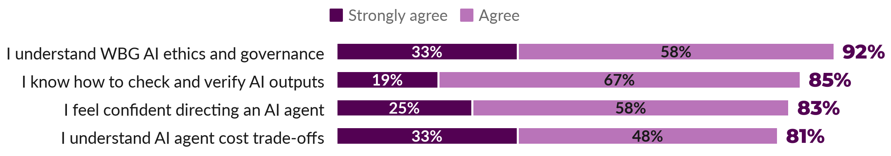

```{=html}
<table role="presentation" width="640" cellpadding="0" cellspacing="0" border="0" style="width:640px; border-collapse:collapse; font-family:Calibri, Arial, sans-serif; font-size:10.5pt; color:#1a1a1a; line-height:1.45;">

<tr><td style="padding:0 0 4px 0; font-size:21pt; font-weight:bold; color:#530153; font-family:Arial, sans-serif;">AI-Enabled Research Bootcamp</td></tr>
<tr><td style="padding:0 0 10px 0; font-size:9pt; color:#6b6b6b; font-family:Calibri, Arial, sans-serif;">Results brief &middot; October 1&ndash;8, 2026 &middot; Led by Impact Analytics (Development Impact) with the Development Data Group and ITS</td></tr>

<tr><td style="padding:0 0 10px 0; font-size:10.5pt;font-family:Calibri, Arial, sans-serif;color:#1a1a1a;"></td></tr>

<tr><td style="padding:0 0 12px 0; font-size:10.5pt;font-family:Calibri, Arial, sans-serif;color:#1a1a1a;"><b>98 staff. 5 days. Agentic AI tools installed on every participant's computer.</b> In the first-ever AI-Enabled Research Bootcamp, participants learned by doing, working with coding agents, memory files, and reusable skills across the research cycle, with instructors in the room throughout to provide customized support. Participant feedback was overwhelmingly positive. Here is where participants started, where they got to, and what comes next.</td></tr>

<tr><td style="padding:0 0 4px 0; font-size:10.5pt;font-family:Calibri, Arial, sans-serif;color:#1a1a1a;">
<table role="presentation" width="640" cellpadding="0" cellspacing="0" border="0" style="width:640px; border-collapse:separate;">
<tr>
<td width="152" valign="top" style="width:152px; background-color:#f4eaf4; border-top:3px solid #800280; padding:8px 10px; font-size:10.5pt;font-family:Calibri, Arial, sans-serif;color:#1a1a1a;"><div style="font-size:19.5pt; font-weight:bold; color:#530153; font-family:Arial, sans-serif;">98</div><div style="font-size:8pt; color:#6b6b6b; font-family:Calibri, Arial, sans-serif;">participants from 15 Vice-Presidential Units</div></td>
<td width="8" style="width:8px; font-size:10.5pt;font-family:Calibri, Arial, sans-serif;color:#1a1a1a;">&nbsp;</td>
<td width="152" valign="top" style="width:152px; background-color:#f4eaf4; border-top:3px solid #800280; padding:8px 10px; font-size:10.5pt;font-family:Calibri, Arial, sans-serif;color:#1a1a1a;"><div style="font-size:19.5pt; font-weight:bold; color:#530153; font-family:Arial, sans-serif;">4.45/5</div><div style="font-size:8pt; color:#6b6b6b; font-family:Calibri, Arial, sans-serif;">average course rating</div></td>
<td width="8" style="width:8px; font-size:10.5pt;font-family:Calibri, Arial, sans-serif;color:#1a1a1a;">&nbsp;</td>
<td width="152" valign="top" style="width:152px; background-color:#f4eaf4; border-top:3px solid #800280; padding:8px 10px; font-size:10.5pt;font-family:Calibri, Arial, sans-serif;color:#1a1a1a;"><div style="font-size:19.5pt; font-weight:bold; color:#530153; font-family:Arial, sans-serif;">93.6%</div><div style="font-size:8pt; color:#6b6b6b; font-family:Calibri, Arial, sans-serif;">rated the bootcamp above their expectations<sup>1</sup></div></td>
<td width="8" style="width:8px; font-size:10.5pt;font-family:Calibri, Arial, sans-serif;color:#1a1a1a;">&nbsp;</td>
<td width="152" valign="top" style="width:152px; background-color:#f4eaf4; border-top:3px solid #800280; padding:8px 10px; font-size:10.5pt;font-family:Calibri, Arial, sans-serif;color:#1a1a1a;"><div style="font-size:19.5pt; font-weight:bold; color:#530153; font-family:Arial, sans-serif;">97.9%</div><div style="font-size:8pt; color:#6b6b6b; font-family:Calibri, Arial, sans-serif;">expect to use what they learned within six weeks</div></td>
</tr>
</table>
</td></tr>
<tr><td style="padding:0 0 10px 0; font-size:7.5pt; color:#6b6b6b; font-family:Calibri, Arial, sans-serif;"><sup>1</sup> Rated 4 or 5 on a 5-point scale (3 = met expectations); 51% gave a 5. Results from feedback survey (49% response rate).</td></tr>

<tr><td style="padding:6px 0 4px 0; border-bottom:2px solid #800280; font-size:13pt; font-weight:bold; color:#530153; font-family:Arial, sans-serif;">Who attended</td></tr>
<tr><td style="padding:8px 0 12px 0; font-size:10.5pt;font-family:Calibri, Arial, sans-serif;color:#1a1a1a;"></td></tr>

<tr><td style="padding:6px 0 4px 0; border-bottom:2px solid #800280; font-size:13pt; font-weight:bold; color:#530153; font-family:Arial, sans-serif;">Where participants started</td></tr>
<tr><td style="padding:8px 0 8px 0; font-size:10.5pt;font-family:Calibri, Arial, sans-serif;color:#1a1a1a;">Nearly all participants (98%) already used AI at work, but mostly as a chat assistant for writing and background research. Few had used the tools the Bootcamp focused on<sup>2</sup>:</td></tr>
<tr><td style="padding:0 0 4px 0; font-size:10.5pt;font-family:Calibri, Arial, sans-serif;color:#1a1a1a;">
<table role="presentation" width="640" cellpadding="0" cellspacing="0" border="0" style="width:640px; border-collapse:separate;">
<tr>
<td width="208" valign="top" style="width:208px; background-color:#f0f0f0; border-top:3px solid #6b6b6b; padding:8px 10px; font-size:10.5pt;font-family:Calibri, Arial, sans-serif;color:#1a1a1a;"><div style="font-size:19.5pt; font-weight:bold; color:#530153; font-family:Arial, sans-serif;">24%</div><div style="font-size:8pt; color:#6b6b6b; font-family:Calibri, Arial, sans-serif;">had ever used a coding agent</div></td>
<td width="8" style="width:8px; font-size:10.5pt;font-family:Calibri, Arial, sans-serif;color:#1a1a1a;">&nbsp;</td>
<td width="208" valign="top" style="width:208px; background-color:#f0f0f0; border-top:3px solid #6b6b6b; padding:8px 10px; font-size:10.5pt;font-family:Calibri, Arial, sans-serif;color:#1a1a1a;"><div style="font-size:19.5pt; font-weight:bold; color:#530153; font-family:Arial, sans-serif;">26%</div><div style="font-size:8pt; color:#6b6b6b; font-family:Calibri, Arial, sans-serif;">had created an AI memory file</div></td>
<td width="8" style="width:8px; font-size:10.5pt;font-family:Calibri, Arial, sans-serif;color:#1a1a1a;">&nbsp;</td>
<td width="208" valign="top" style="width:208px; background-color:#f0f0f0; border-top:3px solid #6b6b6b; padding:8px 10px; font-size:10.5pt;font-family:Calibri, Arial, sans-serif;color:#1a1a1a;"><div style="font-size:19.5pt; font-weight:bold; color:#530153; font-family:Arial, sans-serif;">27%</div><div style="font-size:8pt; color:#6b6b6b; font-family:Calibri, Arial, sans-serif;">had used a reusable AI skill</div></td>
</tr>
</table>
</td></tr>
<tr><td style="padding:0 0 12px 0; font-size:7.5pt; color:#6b6b6b; font-family:Calibri, Arial, sans-serif;"><sup>2</sup> Baseline survey: 63 of 98 responded. It measures prior use and the end-of-course survey measures confidence, so they are not directly comparable.</td></tr>

<tr><td style="padding:6px 0 4px 0; border-bottom:2px solid #800280; font-size:13pt; font-weight:bold; color:#530153; font-family:Arial, sans-serif;">What participants gained</td></tr>
<tr><td style="padding:8px 0 8px 0; font-size:10.5pt;font-family:Calibri, Arial, sans-serif;color:#1a1a1a;">After the week, 83% felt confident directing an AI agent, and participants expect to use about 70% of the content.</td></tr>
<tr><td style="padding:0 0 12px 0; font-size:10.5pt;font-family:Calibri, Arial, sans-serif;color:#1a1a1a;"></td></tr>

<tr><td style="padding:6px 0 8px 0; border-bottom:2px solid #800280; font-size:13pt; font-weight:bold; color:#530153; font-family:Arial, sans-serif;">In participants' words</td></tr>
<tr><td style="padding:10px 0 8px 0; font-size:10.5pt;font-family:Calibri, Arial, sans-serif;color:#1a1a1a;">
<table role="presentation" width="640" cellpadding="0" cellspacing="0" border="0" style="width:640px; border-collapse:collapse;"><tr><td style="background-color:#fbf8fb; border-left:3px solid #800280; padding:8px 12px; font-size:10pt; font-family:Calibri, Arial, sans-serif;color:#1a1a1a;"><i>This was one of (if not "the") most impactful trainings I have taken at the World Bank. [...] I am planning to apply 100% of what I have learned (within the limit of my token allowance :)). I have recommended the training to a lot of my colleagues.</i><div style="font-size:8pt; color:#6b6b6b; font-weight:bold; padding-top:4px; font-family:Calibri, Arial, sans-serif;">&mdash; Bootcamp participant</div></td></tr></table>
</td></tr>
<tr><td style="padding:0 0 8px 0; font-size:10.5pt;font-family:Calibri, Arial, sans-serif;color:#1a1a1a;">
<table role="presentation" width="640" cellpadding="0" cellspacing="0" border="0" style="width:640px; border-collapse:separate;"><tr>
<td width="316" valign="top" style="width:316px; background-color:#fbf8fb; border-left:3px solid #800280; padding:8px 12px; font-size:10pt; font-family:Calibri, Arial, sans-serif;color:#1a1a1a;"><i>I was already quite a heavy user of AI agents, but I still learned so much. [...] I always felt intimidated by skills so far, but now I feel like I will use and explore them much more. I already used the presentation skill for my work and it was impressively effective.</i><div style="font-size:8pt; color:#6b6b6b; font-weight:bold; padding-top:4px; font-family:Calibri, Arial, sans-serif;">&mdash; Bootcamp participant</div></td>
<td width="8" style="width:8px; font-size:10.5pt;font-family:Calibri, Arial, sans-serif;color:#1a1a1a;">&nbsp;</td>
<td width="316" valign="top" style="width:316px; background-color:#fbf8fb; border-left:3px solid #800280; padding:8px 12px; font-size:10pt; font-family:Calibri, Arial, sans-serif;color:#1a1a1a;"><i>[...] And having a dedicated time to really practice repeatedly without forgetting things, and having people close by to troubleshoot with is hard to replicate in a series of one-off sessions.</i><div style="font-size:8pt; color:#6b6b6b; font-weight:bold; padding-top:4px; font-family:Calibri, Arial, sans-serif;">&mdash; Bootcamp participant</div></td>
</tr></table>
</td></tr>
<tr><td style="padding:0 0 12px 0; font-size:7.5pt; color:#6b6b6b; font-family:Calibri, Arial, sans-serif;">Quotes are from anonymous survey responses; [...] marks omitted text, and obvious typos were corrected.</td></tr>

<tr><td style="padding:6px 0 8px 0; border-bottom:2px solid #800280; font-size:13pt; font-weight:bold; color:#530153; font-family:Arial, sans-serif;">Next steps</td></tr>
<tr><td style="padding:10px 0 0 0; font-size:10.5pt;font-family:Calibri, Arial, sans-serif;color:#1a1a1a;">
<table role="presentation" width="640" cellpadding="0" cellspacing="0" border="0" style="width:640px; border-collapse:collapse;"><tr><td style="background-color:#f4eaf4; padding:10px 16px; font-size:10pt; font-family:Calibri, Arial, sans-serif;color:#1a1a1a;">
<ul style="margin:0; padding-left:18px;">
<li style="margin-bottom:6px; font-size:10.5pt;font-family:Calibri, Arial, sans-serif;color:#1a1a1a;"><b>Turning intent into practice.</b> One output of the Bootcamp was a practical AI adoption plan, and nearly all participants (97.9%) plan to apply what they learned within six weeks.</li>
<li style="margin-bottom:6px; font-size:10.5pt;font-family:Calibri, Arial, sans-serif;color:#1a1a1a;"><b>Sustained adoption.</b> Regular Office Hours will provide customized support for sustained adoption of AI tools and skills, and a follow-up survey in two months will measure it.</li>
<li style="margin-bottom:6px; font-size:10.5pt;font-family:Calibri, Arial, sans-serif;color:#1a1a1a;"><b>Building on demand.</b> Interest reaches beyond DEC (15 VPUs), and some participants are already recommending the Bootcamp. We are brainstorming approaches to scaling training with colleagues in DECDG and ITS.</li>
<li><b>Open materials.</b> Course materials are live and public: <a href="https://dime-worldbank.github.io/ai-research-training/bootcamp/" style="color:#800280;">dime-worldbank.github.io/ai-research-training/bootcamp</a>.</li>
</ul>
</td></tr></table>
</td></tr>

</table>
```
