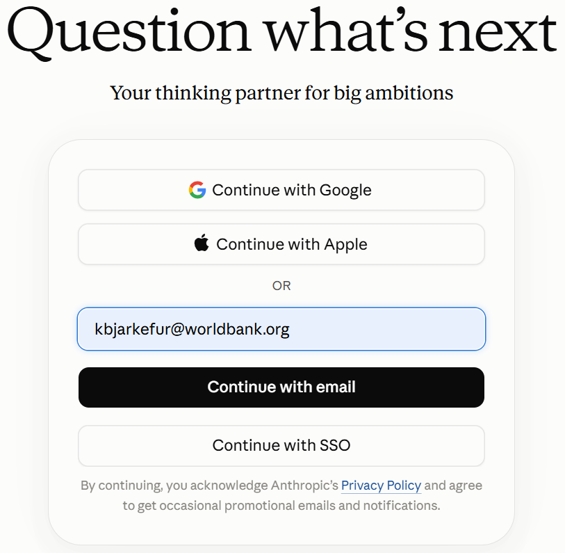
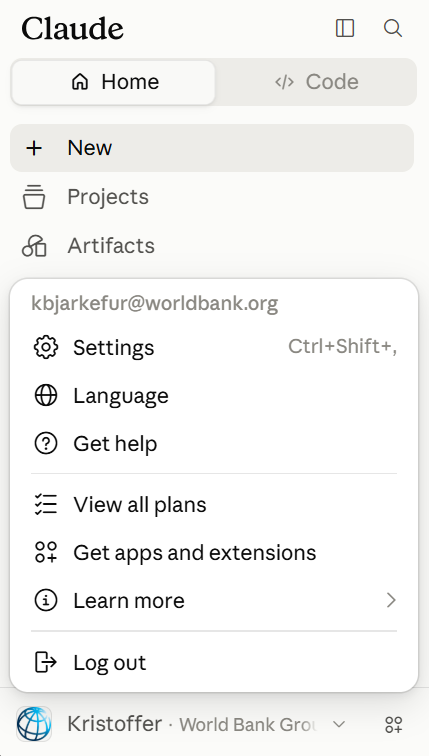

## Objective

* Understand how the many AI interfaces differ from one another
* Understand what those differences mean in practice and when to use each tool
* Understand what is special about Claude Enterprise and why that difference has implications

# Recap on how LLMs work {background-color="#002A4F"}

## No matter which fancy AI tool, it comes down to this:

* image of context window and neural network 

* LLMs are the technology behind all AI related to text generation and understanding.

* Initially, you had to be really good at crafting prompts to get useful outputs from the AI

* Users had a bad intuition for what was needed to get results

* AI engineers had the idea: let's build an interface that helps users with this. They ended up building not one interface, but hundreds of them

## Why are there so many AI interfaces?

* Different use cases and tasks have different requirements - AI interfaces are built to optimize for a specific need.

* Competing interfaces exist for the same use case, with slight differences in features

* Different interfaces add data to your request in different ways. Many of them, especially agents, add data they have access to without your knowledge

## There are a great many models

* AI interfaces are not LLMs themselves; but they make extensive use of them to provide functionality.

* Some AI interfaces can only interact with some models, some AI interfaces can interact with most models.

* Some AI interfaces and models are named similarly, if they are created by the same company.

## What runs where?

* You know where the AI interfaces run, as that is where you interact with them
  * In the browser (mAI, ChatGPT, etc.)
  * A dedicated application on your computer (Claude Desktop or just Claude)
  * Extensions in IDEs such as VS Code (GitHub Copilot or Claude Code)
* What is not as obvious to the user, but has huge implications, is where the models run.
* When OIS approves an AI tool such as mAI, Claude, or GitHub Copilot, this, and almost only this, is what matters.
* Except in what are still advanced use cases, the model runs on a server.
* The same AI interface can be configured to send your data to private servers where no external party has access, or it can be configured to send your data to servers where third parties are allowed to see, save, and use it.

# What differs {background-color="#002A4F"}

## Claude-based chatbots

* Chatbots are AI interfaces designed to interact with users through back-and-forth messages.
* All modern chatbots have access to tools such as calculators, calendars, and web searches. This allows them to do math, tell you what day it is, and find public information on the web.

::: {.columns}

::: {.column}

### mAI

* A chatbot AI interface developed by WB
* Has access to WB databases and can attach that information to your prompts if needed
* Uses a large variety of available commercial models
* These models run on WB-controlled servers in the cloud

:::

::: {.column}

### ChatGPT

* A chatbot AI interface developed by OpenAI
* Does not have access to any WB information that is not publicly available in a web search
* Uses exclusively models developed by OpenAI
* These models run on servers controlled by OpenAI

:::
:::

## Productivity Agents

* Productivity agents typically run on your computer - they typically have access to your files and other resources on your computer
* A common type of productivity agent is a code assistant. It has a lot of extra tools and capabilities needed when browsing your code, finding errors, and suggesting improvements.

::: {.columns}

::: {.column}

### GitHub Copilot - WB License

* A coding agent developed by GitHub
* Typically runs as an extension in VS Code
* Users provide tasks in a chat window, but GitHub Copilot can also suggest edits as you type
* Uses models developed by AI giants such as OpenAI, Anthropic, etc.
* These models run on servers controlled by the respective AI providers, but WB uses enterprise licenses that restrict most third-party access
* Approved for up to _Business Use Only_ data only at the WB

:::

::: {.column}

### Claude Enterprise License

* A coding agent developed by Anthropic
* Typically runs as an extension in VS Code
* Users provide tasks in a chat window
* Uses exclusively models developed by Anthropic
* These models run on servers covered by an extensive WB enterprise agreement under which no data, not even user behavior data, may be collected.
* Approved for _Strictly Confidential_ data at the WB

:::

::: {.column}

### Claude Personal License

* A coding agent developed by Anthropic
* Typically runs as an extension in VS Code
* Users provide tasks in a chat window
* Uses exclusively models developed by Anthropic
* These models run on servers where Anthropic collects and processes user data and, depending on user settings, may save payload data for future use.
* Approved for _Public_ data only at the WB

:::
:::

## Comparison Claude Enterprise vs Personal License

* Image showing the identical interface being used while data is sent to different servers

## Another example for productivity agents

* Microsoft Copilot
* Claude Desktop

# How to use Claude Enterprise

## Three AI interfaces available with Claude Enterprise

* Claude Web: https://claude.ai/
* Claude Desktop: Download from the Company Portal
* Claude VS Code Extension: Open the VS Code Extensions Marketplace and search for "Claude"

## Claude Web

::: {.columns}

::: {.column}

* Once you have been assigned a WB Enterprise license, start by navigating to [Claude Web](https://claude.ai/).
* On the sign-in page, enter your WB email and then wait until the "Sign in with SSO" option appears.
  * If you do not see "Sign in with SSO," make sure you are using a WB email domain such as `@worldbankgroup.org` or `@worldbank.org`.
* Select "Sign in with SSO" and complete the login process.

:::

::: {.column}

:::

:::

## Claude Web - Usage

::: {.columns}

::: {.column}

* Before doing anything, expand the left sidebar and look at the very bottom of it.
* Make sure you are signed in with your WB account - you should see the WB logo and your WB email address.
* Here you can also find Settings, including the important usage page: https://claude.ai/new#settings/usage

This is your web interface for interacting with Claude. Use it for AI-assisted tasks that do not require access to your files.

:::

::: {.column}

:::

:::

## Claude Desktop

* Download Claude Desktop from the Company Portal. You will only be able to find it there if you have already been assigned a WB Enterprise license by ITS.
* While downloading it, make sure you are signed in to Claude Web with your WB account. See the steps on the previous slides.
* After installation, launch Claude Desktop and sign in with your WB account. Again, wait for "Sign in with SSO" to appear and complete the login process.
* Claude Desktop has a very similar interface to Claude Web, but it runs on your computer and has access to your local files.
* Before doing anything, verify that you are logged in to Claude Desktop with your WB account. You should see the WB logo and your WB email address at the bottom of the left sidebar.

## Claude Code VS Code Extension

* Open VS Code and go to the Extensions view in the sidebar, or press `Ctrl/Cmd+Shift+X`.
* Search for "Claude" in the Extensions Marketplace. Install the Claude extension.
* After installation, you need to authorize the extension to use your Claude Enterprise account. You will not be able to choose an account during authorization; it will use the account with which you are signed in to Claude Web, regardless of whether it is an enterprise or personal account. Use the instructions in the Claude Web section above to verify that you are signed in with your WB account.
* Then click `Claude.ai subscription` in the Claude window and follow the steps to authorize access.
* Once completed, enter `/status` in the Claude chat window to verify that you are successfully authorized and connected to your WB Claude Enterprise account.

# When to use Claude Enterprise?

Why not always use Claude Enterprise?

* That would be ideal, but the WB Claude Enterprise setup provides additional data privacy protections.
  * _The good:_ It is approved for strictly confidential data
  * _The bad:_ It is much more expensive than personal licenses, under which Anthropic subsidizes usage in exchange for saving and using our data.

* Learning to use these tools in a token-efficient way is important. There is a separate session on that topic.

* Switching between personal and enterprise licenses can be done, but would be cumbersome and might lead to false security.
  * You are likely to lose track of which account is currently active, as the AI interfaces look the same.
  * It is very hard, if not impossible, to manually control whether Claude shares certain data with Anthropic when using a personal license.

## Claude Enterprise vs GitHub Copilot

* Instead of switching between Claude Enterprise and personal licenses, you might consider using GitHub Copilot for tasks that primarily require coding assistance.
* Since both GitHub Copilot and VS Code are developed by entities owned by Microsoft, one benefit is that GitHub Copilot has a more limited view of the VS Code workspace (i.e., the files you have open in tabs or the project view). By managing what you have open, you can limit GitHub Copilot's access and set up an environment with no confidential data.
* Save Claude Code credits for tasks that require the advanced capabilities of Claude Enterprise.
* Use GitHub Copilot's inline suggestions and next-edit suggestions for simpler tasks. Do not use an extensive context window in Claude for such tasks.
