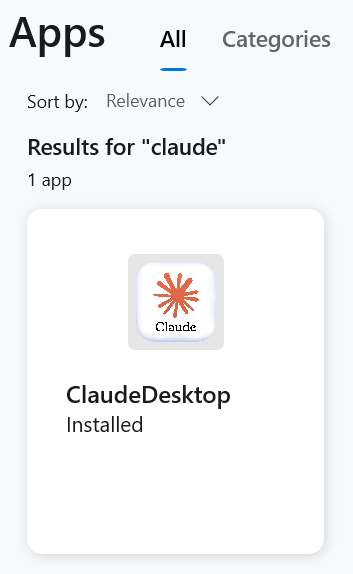
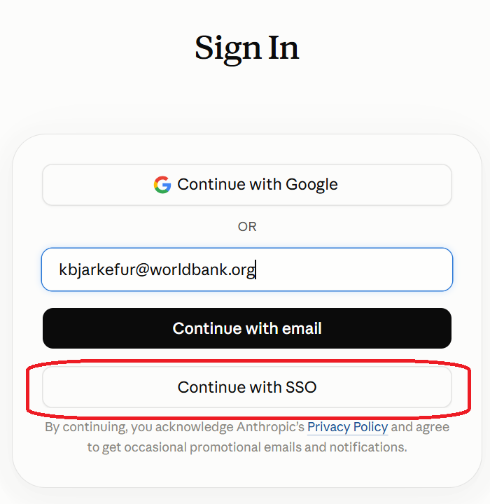
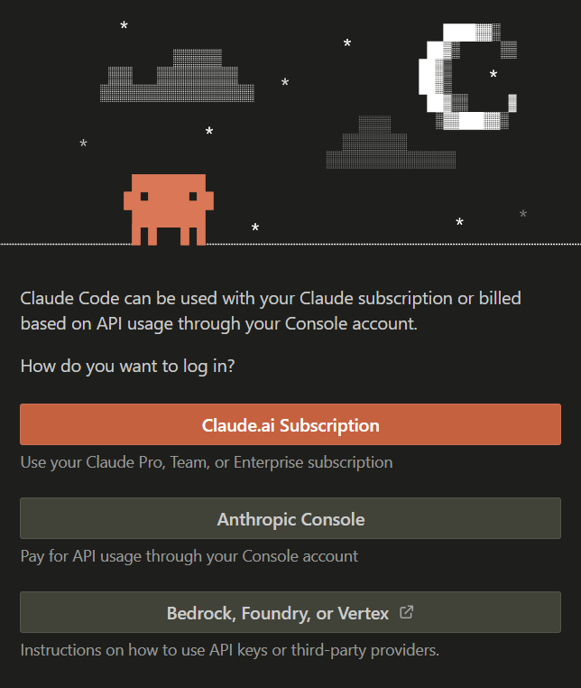
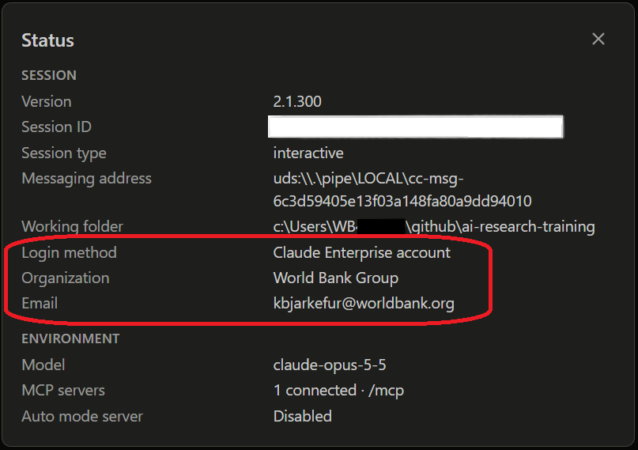

## Outline and objective

```{=html}
<style>
.why-card{border-left:5px solid var(--blue);background:#F5F8FA;padding:.5em .75em;text-align:left;font-size:.72em;line-height:1.4;border-radius:4px; margin-bottom:.5em}
.why-card strong{display:block;color:var(--navy);font-size:1.1em;margin-bottom:.15em}
.flow-grid{display:grid;grid-template-columns:repeat(auto-fit,minmax(0,1fr));gap:.6em;margin-bottom:.5em}
.flow-grid .why-card{margin-bottom:0}
.flow-steps{display:flex;align-items:stretch;gap:.3em;margin-bottom:.3em}
.flow-steps .why-card{flex:1;margin-bottom:0}
.flow-arrow{flex:0 0 auto;align-self:center;color:#2599CD;font-size:1.3em;font-weight:bold}
.why-card.zone-conf{border-left:5px solid #E8833A}
.why-card.zone-safe{border-left:5px solid #2599CD}
.flow-legend{font-size:.6em;text-align:left;margin-bottom:.4em}
.flow-legend span{display:inline-block;width:.8em;height:.8em;margin:0 .3em 0 1em;vertical-align:middle}
.small-code pre code{font-size:.6em;line-height:1.3}
.small-text{font-size:.75em}
.small-table table{font-size:.72em}
.small-table td,.small-table th{padding:.3em .5em !important}
</style>
```

* Understand how the many AI interfaces differ from one another
* Understand what those differences mean in practice and when to use each tool
* Understand what is special about Claude Enterprise and why that difference has implications
* Know which workflow to follow for confidential, de-identified and public work

# Recap on how LLMs work {background-color="#002A4F"}

## No matter which fancy AI tool, it comes down to this:



* An AI interface allows us to send a task to an LLM - think of the context window as your prompt, but in modern AI interfaces it is much more than that
* The first interfaces did not help you write prompts - you had to be good at crafting prompts yourself to get good answer - this was when "prompt engineering" was the biggest buzz word

::: {.fragment}
* Regular users had a bad intuition for what was needed to get really good results 
:::
::: {.fragment}
* AI engineers had the idea: let's build an interface that helps users with this. 
:::

## They built not one interface, but hundreds...



## Why are there so many AI interfaces?

* Different use cases and tasks have different requirements and the different AI interfaces are built to optimize for a specific need.
* Different interfaces add different information to your context window depending on the use case they are optimized for

:::: {.small-table}
::: {.list-table}

- - AI interface
  - Purpose

- - ChatGPT
  - Conversational AI for general-purpose tasks - can add publicly available information to your prompts

- - mAI
  - Conversational AI for general-purpose tasks - can add publicly available information **_as well as_** some WB-specific information to your prompts

- - GitHub Copilot
  - AI assistant for coding tasks - can add relevant context from your code files to your prompt, and have access to coding best practices

- - Claude Agent
  - AI assistant for various tasks, including code assistance - can find files across your file system to add to your prompts

- - Air France's Customer Support
  - Conversational AI for very Air France specific tasks - can add information about Air France's policies and your reservation to your prompt (chat message)
:::
::::

## There are also a great many language models...



* The AI interfaces you see and interact with are not themselves LLMs; they help you use them.
* AI interfaces are software; models are advanced mathematics (linear algebra matrices with proprietary confidential weights).

## Some interfaces use most models



## Some interfaces use only specific models



**Important for the rest of this presentation:** Claude/Claude Code is an interface that you can run on your computer. Despite they are similarly named to the models it uses, _an interface and a model are complete separate entities_.

## What runs where?



* You can usually tell where the AI interfaces run: In the browser (mAI, ChatGPT, etc.), application on your computer (Claude Desktop App), or IDE extension (GitHub Copilot or Claude Code)
* It is often easy to tell the name of the model the interface uses (GPT-5.5, Claude Opus, etc.)

::: {.fragment}
* What is not as obvious to the user, **_but makes the whole data privacy difference_**, is where the models run.
:::


## What matters for data privacy and data ethics?

**Central to ITS/OIS approval of an AI solution for non-public data are where the model runs and who has access to the data you provide to it.**

_What matters for where the model runs?_

```{=html}
<div class="why-grid">
  <div class="why-card"><strong>Does the interface matter?</strong>
  Indirectly yes, as the interface determines which model-hosting server your data is being sent to
  </div>
  <div class="why-card"><strong>Does the model matter?</strong>
  Not really, as the model is just math. It's like asking whether OLS vs. IV, or addition vs. multiplication, matters for data privacy
  </div>
  <div class="why-card"><strong>Does the license matter?</strong>
  Absolutely! The private model-hosting servers are much more expensive to use. It costs the same to run private servers, but non-private servers are subsidized as the AI companies want to save and use our data
  </div>
</div>
```

Unless you've read up extensively on the AI interface and its configurations, your intuition alone is likely not enough to determine the privacy and security implications.

## The same interface can be configured differently



```{=html}
<div style="height: 2em;"></div>
```



# Overview of tools {background-color="#002A4F"}

## Table of AI Options at the WB

:::: {.small-table}
::: {.list-table}

- - AI interface
  - Purpose
  - Models
  - Classification

- - ChatGPT
  - General purpose LLM chatbot
  - Only OpenAI models
  - Public

- - mAI
  - General purpose LLM chatbot with WB knowledge
  - Claude, Gemini, OpenAI, etc.
  - Strictly Confidential

- - mAI Factory
  - API integration platform for various AI models
  - Claude, Gemini, OpenAI, etc.
  - Strictly Confidential

- - Claude Cowork Enterprise
  - AI assistant for automating recurring general tasks 
  - Only Claude models
  - Strictly Confidential

- - Microsoft 365 Copilot
  - AI assistant specialized in Microsoft 365 (Word, Excel, PowerPoint, Outlook etc.)
  - OpenAI and Claude models
  - Strictly Confidential

- - _Coding Agents_

- - Claude Code Enterprise
  - AI assistant for various tasks, including coding 
  - Only Claude models
  - Strictly Confidential

- - GitHub Copilot Enterprise
  - AI assistant for coding tasks 
  - OpenAI, Claude, etc.
  - Official Use

- - Claude Code Personal
  - AI assistant for various tasks, including coding 
  - Only Claude models
  - Public

- - GitHub Copilot Personal
  - AI assistant for coding tasks 
  - OpenAI, Claude, etc.
  - Public

:::
::::

# What Makes Claude Enterprise Different {background-color="#002A4F"}

## Three AI interfaces available with Claude Enterprise



See [appendix A](#appendix-a-how-to-use-claude-with-wb-enterprise-license) for details how to access and use these interfaces using the WB enterprise license.

## Comparison Claude Enterprise vs Personal License

The same Claude interfaces, with different licenses will behave and look very similarly, but where the model runs differs. That makes a significant difference in terms of data privacy, security, and costs.

A cheaper personal license might have fewer features and access to only smaller models.

```{=html}
<div style="height: 2em;"></div>
```


::: {.columns}
::: {.column}

##### Enterprise License



:::
::: {.column}

##### Personal License



:::
:::

## Why this difference and what does it do to costs?


::: {.fragment}
* Running these models is expensive - **_very_ expensive**.
:::
::: {.fragment}
* **It is not that enterprise credits are expensive** as they are priced for what it costs to run these models
:::
::: {.fragment}
* Instead, **personal licenses credits are artificially cheap** as Anthropic subsidizes the usage in return for getting access to your data
:::
::: {.fragment}
* The more expensive personal subscription, the more you can switch off, but you can never fully opt out of all data collection unless you sign an enterprise license agreement
:::
::: {.fragment}
* Personal license tiers such as **Max and Pro plans are not offered to enterprise users with extensive privacy agreements**, as Anthropic would lose too much money on that since they wont be benefitting from using our data
:::
::: {.fragment}
* **$20 for a personal license will give you much more usage compared to what $20 with an enterprise license does** - this is the premium we pay for privacy.
:::

## Claude is great, but so is GitHub Copilot

GitHub Copilot's credits are cheaper, use GitHub Copilot whenever appropriate. 

Microsoft owns both GitHub Copilot and VS Code, and therefore some neat integrations exists between the two.

* **Use inline suggestions and next-edit suggestions** for simple edits. They are built into the editor and a very cheap way to do routine coding tasks.
* **Copilot sees the folder you open in VS Code**, not just your open tabs. Keep confidential data **outside** that folder
  * Not a watertight protection as the **agent mode can run commands or a project script** that reach files anywhere on your computer - with all agents, read and try to understand what commands is ask for perimisson to run
* GitHub Copilot is optimized for coding tasks while Claude is better suited for general tasks or complex reasoning that may or may not include code.
  * **Move to Claude only when Copilot struggles with your task:** with public work → Claude personal; with confidential data → Claude Enterprise

# Recommended workflows {background-color="#002A4F"}

## Why not always use Claude Enterprise?

* That would be ideal, but the extra protections come at a cost:
  * _The good:_ It is approved for strictly confidential data
  * _The bad:_ It is much more expensive than personal licenses, under which Anthropic subsidizes usage in exchange for saving and using our data

* Learning to use these tools in a token-efficient way is important and applicable regardless which AI interface you are using (GitHub Copilot, Claude, etc.). There is a separate session on that topic.

* Switching between personal and enterprise licenses is possible, **but only with a deliberate routine**:
  * The interfaces look the same, so it is easy to lose track of which account is active
  * Claude Code has support for settings that limits what it can access. This is not needed for enterprise licenses, but _we strongly recommend it for personal licenses_. **Important: While these settings reduce the risk, they do not remove it entirely**

* The next slides give a recommended workflow for each situation and further details can be found in [Appendix B](#appendix-b-workflow-details-using-enterprise-and-personal-license)

## Pick the tool by task and data

::: {.list-table}

- - Your task involves...
  - Use

- - Identified or confidential data: PII scans, cleaning raw survey data, matching records on names
  - **Claude Enterprise**

- - Writing or fixing code. If using confidential data, replace it with a codebook or synthetic data
  - **GitHub Copilot** (default for coding)

- - Public data, generic code, learning, drafting from public sources
  - **Personal license** is acceptable, with the setup on the following slides

:::

**When in doubt, use Enterprise.**

## Workflow A: Confidential data goes to Enterprise


Examples:

* **PII scans:** ask the agent to flag direct and indirect identifiers before data is shared
* Cleaning or processing **identified data**, such as raw survey data with names, phone numbers or GPS coordinates
* **Record linkage**: matching records across datasets on names or IDs
* Reviewing or summarizing **documents classified as Confidential or Strictly Confidential**

Also a good use of Enterprise credits: **building a codebook and a synthetic dataset once** (Workflow B), so the rest of the project can use cheaper tools.

## Workflow B: De-identify first, then code

```{=html}
<div class="flow-steps">
  <div class="why-card zone-conf"><strong>1. Start from the raw data</strong>
  Identified, confidential data stays with you, or in Claude Enterprise
  </div>
  <div class="flow-arrow">→</div>
  <div class="why-card zone-conf"><strong>2. Build a codebook and synthetic data</strong>
  Variable names, types and meanings with no actual values, plus a small fake dataset with the same structure. Do this yourself or with Claude Enterprise
  </div>
  <div class="flow-arrow">→</div>
  <div class="why-card zone-safe"><strong>3. Code with the fake data</strong>
  Use GitHub Copilot (or personal Claude) with only the codebook and synthetic data
  </div>
  <div class="flow-arrow">→</div>
  <div class="why-card zone-conf"><strong>4. Run on the real data yourself</strong>
  The AI writes the code; you run it on the real data outside the AI tool
  </div>
</div>
<div class="flow-legend"><span style="background:#E8833A"></span>Real data: you or Claude Enterprise<span style="background:#2599CD"></span>No real data: GitHub Copilot or personal Claude</div>
```

* **A codebook can leak too.** Strip value labels, minimum and maximum values, and category lists that name places or people.
* **De-identified does not mean safe for every tool.** GitHub Copilot is classified as _Official Use_. Give it codebooks and synthetic data, not the de-identified data itself.

## Workflow C: When is a personal license acceptable?

::: {.columns}
::: {.column}

##### Acceptable

* Public data (published datasets, WDI, etc.)
* Generic code with no project-specific details
* Learning a new language, package or method
* Drafting from public sources
* Coding against synthetic data (Workflow B)

:::
::: {.column}

##### Not acceptable

* Any identified or confidential data
* Code that loads confidential data, if Claude runs it
* Unpublished results, embargoed numbers
* Internal documents
* Anything you would not post publicly

:::
:::

**A personal license only covers information you would classify as _Public_.**

## How to switch safely: Enterprise to personal

* **Before starting a project:** check which account is active
  * Claude Code: `/status`
  * Claude Web or Desktop: look for the WB logo and your email at the bottom of the sidebar
  * See [Appendix A](#appendix-a-how-to-use-claude-with-wb-enterprise-license) for more details
* **To switch:** `/logout`, then `/login`
  * The VS Code extension follows whichever account Claude Web is signed into, so switch there first
* **After switching:** start a new session. Never continue a conversation that began under the other account
* **Moving from personal to Enterprise** needs no precautions. Moving from **Enterprise to personal** in the middle of a task needs a handoff (next slide)

## Switching mid-task: Enterprise to personal

1. **Ask Enterprise for a handoff summary**, for example:

> _Write a handoff note so another assistant can continue this task without access to the data. Include the goal, what has been done so far, the current problem, and the next steps. Describe datasets only by structure: generic variable names, types and what they represent. Do not include any data values, statistics, results, names of people, places or projects, or file paths. Use placeholders like `[dataset A]` where needed._

2. **Read the summary yourself** before pasting it. You are the last check.
3. **Continue in a clean folder** with code only: no data, logs, outputs or notebooks with saved results.
4. **Paste the summary into a new session** with the personal account.

## Personal license: account settings to check

* **Turn off "Model Improvement"** at claude.ai → Settings → Privacy
  * This also covers Claude Code sessions
  * It limits how Anthropic uses your data, but **does not make the account safe for confidential data**. Conversations flagged for safety review can still be used
* **Don't link work accounts:** on the personal account, don't connect Google Drive, email or other services that contain work files (Settings → Connectors)
* **Claude Desktop: watch which folders you open.** Only give the personal account access to folders with nothing confidential in them

## Personal license: Claude Code settings

* **Start in Manual mode, not Auto**, so Claude asks before acting
* **Block reads outside the project folder.** By default, Claude can read files anywhere your Windows account can reach
* **Block datasets:** deny access to data files (`.dta`, `.csv`, `.xlsx`) and folders with confidential files
* **Block running code:** stop Claude from running Stata, R or Python, and run scripts yourself. Otherwise a script can load the data and print it into the chat
* **Check the setup:** `/permissions` shows the active rules; `/status` shows the active account

::: {.callout-note title="Note"}
* **Not watertight:** approvals you click through without reading still get through.
* **How to set this up:** see [Appendix B: Personal license settings](#appendix-b-workflow-details-using-enterprise-and-personal-license) for details.
* **Advanced: set up two profiles**, one for Enterprise and one for personal, each with its own login and settings. See [Appendix B2](#b2-why-set-up-two-profiles) and [Appendix B3](#b3-set-up-two-profiles-in-vs-code).
:::

## How data slips through even when you're careful

```{=html}
<div class="flow-grid">
  <div class="why-card"><strong>Debugging a do-file</strong>
  You ask Claude to fix <code>clean.do</code>. It runs the file, and the output prints <code>list in 1/5</code> and <code>summarize</code>. Five household records are now in the chat, without Claude ever opening the data file.
  </div>
  <div class="why-card"><strong>"Find the survey file"</strong>
  Claude cannot find the data in the project folder, so it searches your user folder and opens the copy on OneDrive. You clicked "Allow" without reading the prompt.
  </div>
  <div class="why-card"><strong>"Why do these results look off?"</strong>
  Claude opens <code>output/tables.tex</code> or a <code>.log</code> file with unpublished estimates. The code was clean; the outputs in the same folder were not.
  </div>
</div>
```

**Rule of thumb:** on a personal license, assume Claude can see anything in the folder, and anything your code prints.

## Where to go when a tool runs out

:::: {.small-table}
::: {.list-table}

- - Your work involves...
  - Start with
  - Move on when...

- - **Confidential data:** chat, writing, documents
  - **mAI** or **Microsoft 365 Copilot**: no usage limit
  - They can't do the task (for example, it needs work across many files) → **Claude Enterprise**

- - **Confidential data:** code or files
  - **Claude Enterprise**
  - Credits run low → de-identify and move the coding to Copilot (Workflow B), or request more credits

- - **De-identified work:** codebook or synthetic data
  - **GitHub Copilot**
  - Copilot runs out → **Claude personal**, with the safe setup

- - **Public data**, generic code, learning
  - **Claude personal** or GitHub Copilot
  - Switch between them

:::
::::

**Running out of credits is never a reason to move confidential data to a personal license or to GitHub Copilot.**

## Ask for more credits

* If you run out of Claude Code credits, you can request additional credits from your WB administrator.
* It is unlikely that what you initially was allocated will be sufficient when you are a power user of Claude - so we expect many of you to do so.
* However, if you do not feel like a power user of Claude yet, and still run out of credits, also ask yourself if there is a more efficient way to use your existing credits before requesting hundreds of dollars more in credit.

* To request more Claude credits:
  * Have a conversation with your manager, as the unit's BB will be charged.
  * Agree on a new spending limit. Only actual usage will be charged to the BB.
  * Submit this [eServices request](https://worldbankgroup.service-now.com/wbg/en/productivity-software-license-request?id=wbg_sc_catalog&sys_id=ebfd4d6693065210a2f6fd647aba10d7). 
  * The form includes the required manager approval workflow
  * Once approved, credits are available in all of your WB approved Claude products, including Claude Code.

# Thank you! Questions? {background-color="#002A4F"}

Found a task where GitHub Copilot fell short and Claude succeeded, or the other way round? Please share it with us.

# Appendices {background-color="#002A4F"}

# Appendix A: How to Use Claude with WB Enterprise License {background-color="#002A4F"}

## A1: Three AI interfaces available with Claude Enterprise



## A2: Claude Web

::: {.columns}

::: {.column}

* Once you have been assigned a WB Enterprise license, start by navigating to [Claude Web](https://claude.ai/).
* On the sign-in page, enter your WB email and then wait until the "Sign in with SSO" option appears.
  * If you do not see "Sign in with SSO," make sure you are using a WB email domain such as `@worldbankgroup.org` or `@worldbank.org`.
* Select "Sign in with SSO" and complete the login process.

:::

::: {.column}


:::

:::

## A3: Claude Web - Usage

::: {.columns}

::: {.column width="70%"}

#### First: 

* Expand the left sidebar and look at the very bottom of it.
* Make sure you are signed in with your WB account - you should see the WB logo and your WB email address.
* Here you can also find Settings, including the important usage page: [https://claude.ai/new#settings/usage](https://claude.ai/new#settings/usage)

#### When to use Claude Web:

* This is your web interface for interacting with Claude. 
* Use it for AI-assisted tasks that do not require access to your files
* Similar to when you use mAI, but Claude WB does not have WB knowledge

:::
::: {.column width="30%"}


:::
:::


## A4: Claude Desktop

::: {.columns}
::: {.column width="50%"}

* Download Claude Desktop from the Company Portal. Search for `Company Portal` in your Windows Start menu.
* Search for `Claude`/`Claude Desktop` within the Company Portal. You will only be able to find it after you have been assigned a WB Enterprise license by ITS.
* While downloading it, make sure you are signed in to Claude Web with your WB account. See the steps on the previous slides.
* After installation, launch Claude Desktop and sign in with your WB account. Again, wait for "Sign in with SSO" to appear and complete the login process.

:::
::: {.column width="20%"}



:::

::: {.column width="30%"}



:::
:::

## A5: Claude Desktop - Usage


::: {.columns}

::: {.column width="70%"}

#### First: 

* Claude Desktop has a very similar interface to Claude Web, but it runs on your computer and can access your local files.
* Before doing anything, verify that you are logged in to Claude Desktop with your WB account. You should see the WB logo and your WB email address at the bottom of the left sidebar.

#### When to use Claude Desktop:

* Use Claude Desktop for AI-assisted tasks that require access to your local files.
* Similar to when you use mAI, but Claude Desktop can interact with files on your computer.
* You also have (or will have) access to Claude Cowork where you can automate tasks and workflows involving your local files - although, Microsoft Copilot may offer a more cost-effective way to do so

:::
::: {.column width="30%"}


:::
:::

## A6: Claude Code VS Code Extension

::: {.columns}
::: {.column width="70%"}

* Open VS Code and go to the Extensions view in the sidebar, or press `Ctrl/Cmd+Shift+X`.
* Search for "Claude" in the Extensions Marketplace. Install the Claude extension.
* After installation, you need to authorize the extension to use your Claude Enterprise account. You will not be able to choose an account during authorization; it will use the account with which you are signed in to Claude Web, regardless of whether it is an enterprise or personal account. Use the instructions in the Claude Web section above to verify that you are signed in with your WB account.
* Then click `Claude.ai subscription` in the Claude window and follow the steps to authorize access.

:::
::: {.column width="30%"}



:::
:::

## A7: Claude VS Code - Usage

::: {.columns}
::: {.column width="60%"}

#### First:

* Once completed, enter `/status` in the Claude chat window to verify that you are successfully authorized and connected to your WB Claude Enterprise account.

#### When to use Claude Code in VS Code:

* Use Claude in VS Code for AI-assisted coding tasks and interactions with your local code files.
* Claude Code is very "context hungry" and will add a lot of your codebase to the context window.
* **Switch from `Auto` (the default) to `Manual` mode.** Auto approves costly tasks on its own and can read files outside the workspace.
* Claude Code assumes you are a developer. If it uses jargon, ask it to explain more simply.
:::
::: {.column width="40%"}



:::
:::

# Appendix B: Workflow details using Enterprise and Personal license {background-color="#002A4F"}

## B1: Personal license settings

::: {.columns}
::: {.column width="50%" .small-text}

Add to `C:\Users\<you>\.claude\settings.json` (create it if it doesn't exist):

* `defaultMode`, `disableAutoMode`: start in Manual mode and remove Auto
* `blockReadsOutsideWorkingDirectories`: no reading outside the project folder
* `Read(...)`: block confidential folders and data files
* `Bash(...)`: block running Python, R and Stata
* VS Code: also set `claudeCode.initialPermissionMode` to `default`
* Check with `/permissions`

::: {.callout-warning title="Caveat: this applies to both accounts"}
The settings file belongs to your computer, not to an account. When you are signed in to Enterprise, Claude is restricted too: it cannot read your data files or run your scripts. To avoid this, set up two profiles (Appendices 2–3), or remove the rules when working on Enterprise.
:::

:::
::: {.column width="50%" .small-code}

```json
{
  "permissions": {
    "defaultMode": "default",
    "disableAutoMode": "disable",
    "blockReadsOutsideWorkingDirectories": true,
    "deny": [
      "Read(//c/Users/<you>/OneDrive - WBG/**)",
      "Read(**/*.dta)",
      "Read(**/*.csv)",
      "Read(**/*.xlsx)",
      "Bash(python *)",
      "Bash(Rscript *)",
      "Bash(*stata*)"
    ]
  }
}
```

:::
:::

## B2: Why set up two profiles?

* Normally Claude Code has **one** login and **one** settings file per computer
  * Switching accounts means `/logout` and `/login` each time, and it is easy to forget which one is active
  * The strict personal-license settings also restrict your Enterprise work
* With two profiles, each account gets **its own folder** with its own login and settings:
  * **Normal profile → Enterprise**, with normal settings. This is the safe default
  * **Personal profile → personal account**, with the strict settings from [Appendix B1](#b1-strict-personal-license-settings)
* No logging in and out: which account you get depends on which profile you open
* Officially supported: [Log in with multiple accounts](https://code.claude.com/docs/en/authentication)
* Applies to Claude Code (terminal and VS Code). For Claude Web, use a separate browser profile for the personal account

## B3: Set up two profiles in VS Code

::: {.small-code}

1. **Normal profile on Enterprise:** in the Claude panel, `/status` should show your WB email. If not, `/logout` and sign in with WB SSO
2. **Create the personal settings folder:** `C:\Users\<you>\.claude-personal`, with a `settings.json` containing the  [Appendix B1](#b1-strict-personal-license-settings) settings
3. **Create a VS Code profile:** gear icon → Profiles → New Profile → name it `Claude Personal`, copied from your current profile
4. **Point it to the personal folder:** in that profile, `Ctrl+Shift+P` → _Preferences: Open User Settings (JSON)_ and add:

```json
"claudeCode.environmentVariables": [
  { "name": "CLAUDE_CONFIG_DIR", "value": "C:\\Users\\<you>\\.claude-personal" }
],
"claudeCode.initialPermissionMode": "default"
```

5. **Reload and sign in** with your personal account. Check with `/status`
6. **Test:** the normal profile still shows WB, and the personal profile shows your personal email

:::

