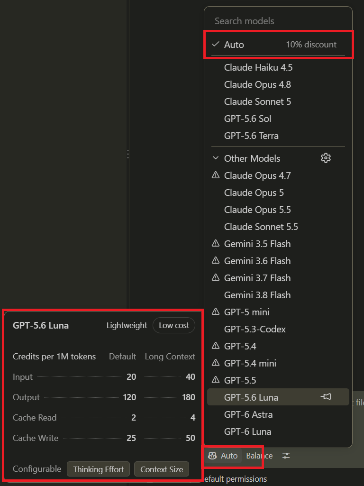
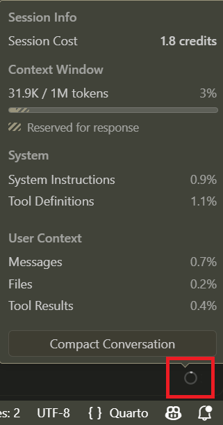

## Use Appropriate Models

:::: {.columns .v-center-container}
::: {.column width="65%" }

- This is an art and not a science. Experiment with models to find the smallest one sufficient for a type of task.
- A good memory file makes it possible to use a smaller model, as the "just-in-case groceries" will not take up space.
- Using `auto` gives you a small discount - but when token subsidies end, you will save much more money by knowing how to use models appropriate for the task.

:::
::: {.column width="35%" }

:::
::::

## Start New Sessions

:::: {.columns .v-center-container}
::: {.column width="75%" }

- You can see how full your current context window is in GitHub Copilot's extension in VS Code.
- This can help you determine whether you used an appropriately sized model at the end of a session:
  - `< 5%` could suggest you used a too big model - cost inefficient
  - `> 95%` could suggest you used a too small model - details were probably lost
- But this also shows you how much payload you would submit again if you reused the session for a new task.
- Use the plus button at the top of the chat window to start a new session for each new task.
:::
::: {.column width="25%" }

:::
::::

## How Do I Repeat the Same Prompt on Several Files or Cases?

- Once you have typed up a great prompt - for example, a prompt about exactly how you want a Quarto slide to be proofread for an _AI-Enabled Research Bootcamp_ session you are about to hold - it would be great to reuse it.
- Instead of using the same chat window and asking the agent "and now this slide as well" on each Quarto slide, copy the prompt and paste it into a new session.
- If you find yourself copying the same prompt repeatedly, then this is a great case for a skill, which we will cover in a later session...